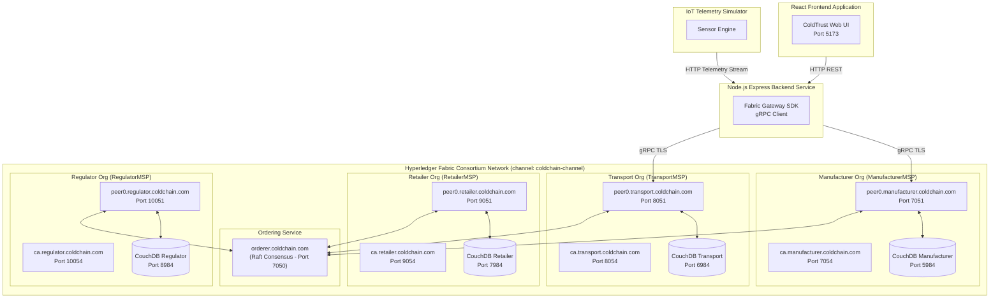
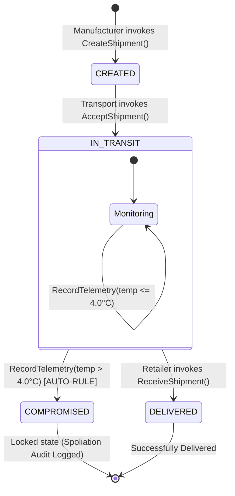
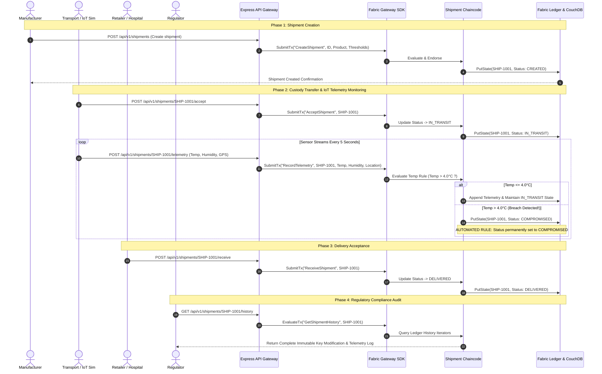
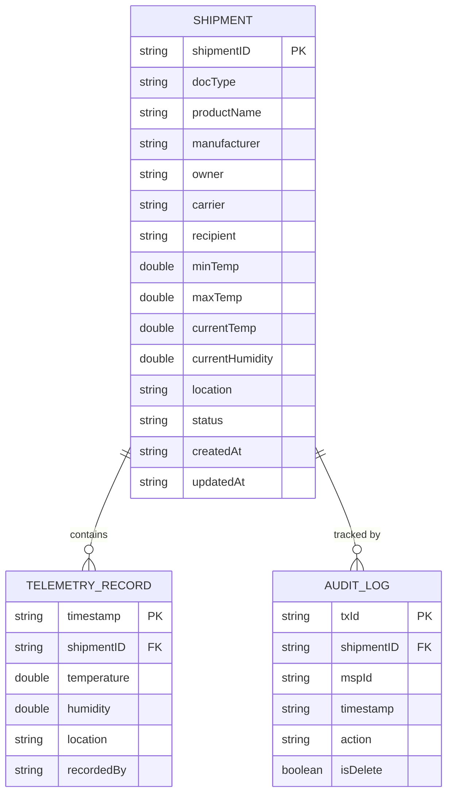

# Architecture Diagrams & Flowcharts
## ColdTrust – Enterprise Global Cold Chain Network

**Document Version:** 1.0.0  
**Date:** August 2026  

---

## 1. Consortium Network Topology Diagram

The diagram below illustrates the 4-Organization Hyperledger Fabric consortium network infrastructure, including Peer nodes, CouchDB world state databases, Certificate Authorities, and the Raft Orderer.

---

## 2. Shipment Lifecycle State Machine

---

## 3. End-to-End Sequence Diagram

---

## 4. Entity Data Model (ERD)

